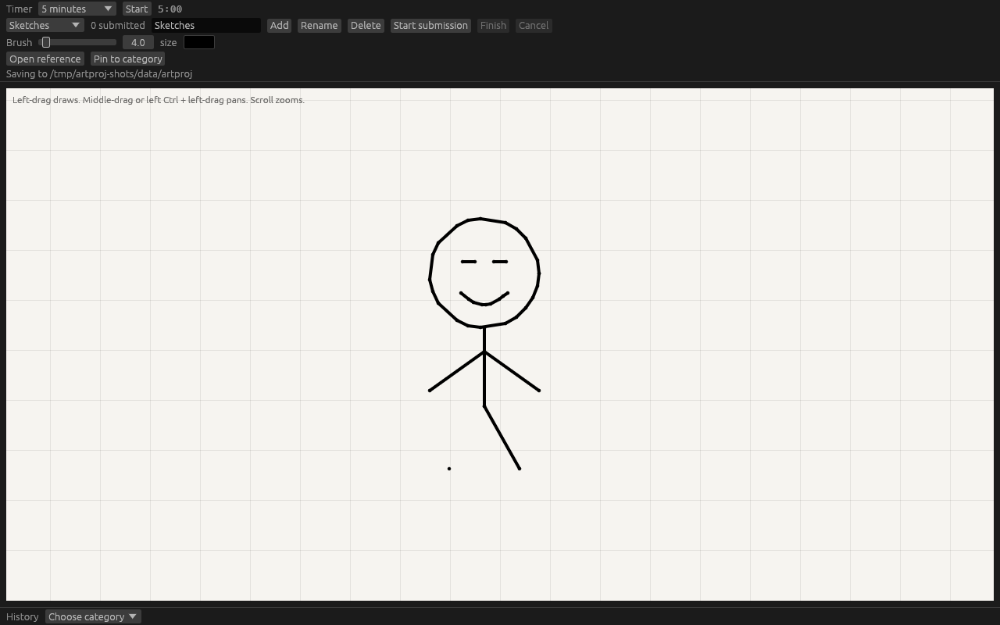
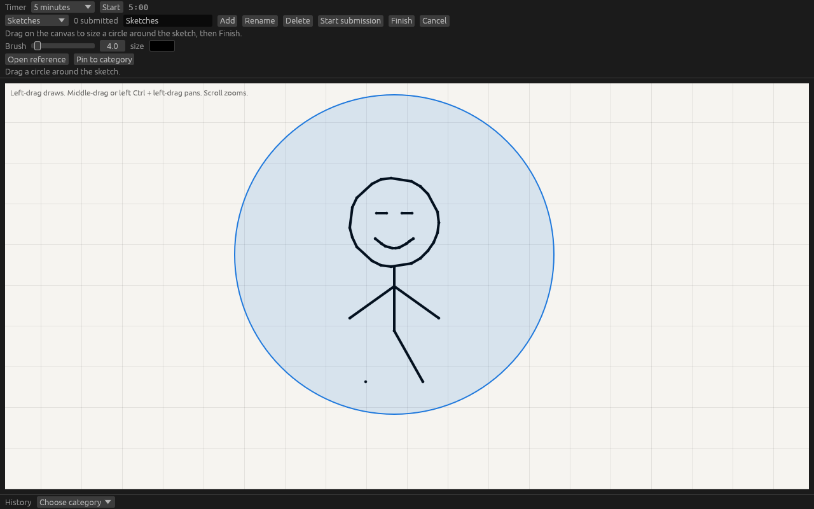
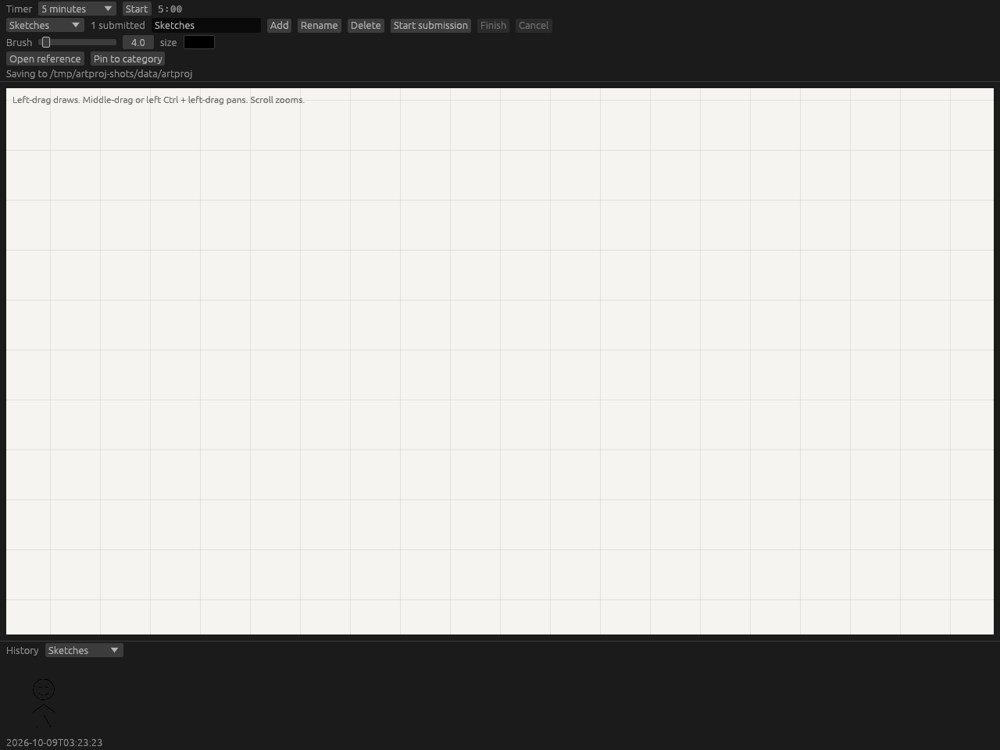

A small desktop app for timed sketches. The canvas is infinite, the brush is a single round pen, and a finished sketch is saved by dragging a circle around it.

## Screenshots

Drawing on the canvas. The status line shows the folder where files are saved.



Start submission, then drag a circle around the sketch. Finish saves that region and clears it from the canvas.



The history strip for a category, oldest first.



## Run

Requires Rust 1.98 or newer.

```bash
cargo run
```

```bash
cargo test
```

The window title is `QuickSketch`. The status line shows the folder where sketches and settings are stored. On Linux that is usually `~/.local/share/QuickSketch`. If the standard data directory cannot be found, files go in `QuickSketch-data` next to the working directory.

## Drawing

- Left-drag draws.
- Middle-drag pans. Left Ctrl + left-drag pans the same way.
- Scroll zooms toward the pointer.
- Two-finger pinch zooms toward the gesture.
- Two-finger drag pans.

The brush has a size slider and a color picker. **Clear canvas** drops every stroke on the canvas and does not save them. A submission circle in progress is cancelled too. Strokes otherwise stay until you submit a region or quit. Quitting does not save the canvas itself, only categories, pinned references, and the submission index.

## Timer

The timer dropdown has 30 seconds, 5 minutes, 20 minutes, and Custom. Custom is a seconds field from 1 to 86400. **Start** begins the countdown. At zero it stays at `0:00`. Drawing is never locked.

## Categories

The category dropdown chooses where the next submission goes. The number beside it is how many sketches have been saved in that category.

Type a name and use **Add**, **Rename**, or **Delete**. Deleting a category removes it from the history list. Image files already written to disk are left in place. The first launch starts with a category named Sketches.

## Submitting a sketch

1. Choose the category.
2. Press **Start submission**.
3. Drag on the canvas. The press sets the center and the drag sets the radius.
4. Press **Finish**.

Finish is available once the circle radius is at least 4 world units. It writes a PNG cropped to the circle on a white background, removes only the ink inside that circle, and adds the sketch to the category history. **Cancel** drops the circle and leaves the canvas unchanged.

## References

**Open reference** picks a PNG, JPEG, WebP, GIF, or BMP in a file dialog and opens it in a separate window. **Pin to category** copies that file into the active category so it stays available if the original moves. Click a pinned thumbnail to open it again. **Keep on top** holds the reference window above the drawing window.

## History

The history dropdown lists the same categories. Choosing one shows that category’s submissions in a horizontal strip, oldest first. Each entry is the saved PNG plus the time it was submitted. Clicking a thumbnail opens that saved image in its own window.

## Saved files

| Path | Contents |
| --- | --- |
| `state.json` | Categories, pinned reference names, and the submission index |
| `sketches/<category-id>/<timestamp>.png` | Submitted sketches |
| `refs/<category-id>/` | Copies of pinned reference images |

Category folders use ids such as `c1`, not the display name, so renaming a category does not move its files.

#TODO:
- Make interface more natural
- Make category addition more obvious
- bug fixes
- TBD
